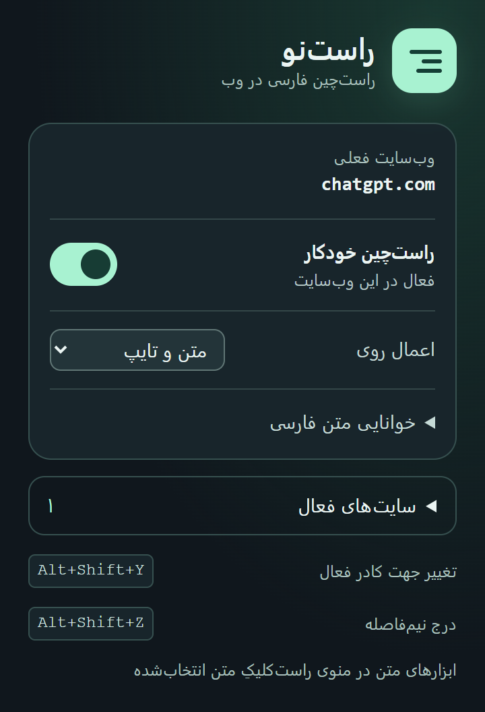

<h1>راست‌نو</h1>

پیام‌ها و نوشته‌های فارسی را در سایت‌های دلخواهت راست‌چین بخوان و بنویس. برای هر سایت می‌توانی متن صفحه، کادر تایپ یا هر دو را انتخاب کنی.

<h2>نصب از سورس</h2>
<ol>
<li>مخزن را دانلود و فایل ZIP را استخراج کن.</li>
<li>در <code>chrome://extensions</code> یا <code>edge://extensions</code>، گزینهٔ <b>Developer mode</b> را روشن کن.</li>
<li>روی <b>Load unpacked</b> بزن و پوشهٔ حاوی <code>manifest.json</code> را انتخاب کن.</li>
<li>در سایت دلخواه، راست‌نو را باز کن و «راست‌چین خودکار» را روشن کن. انتخابت برای دفعات بعد ذخیره می‌شود.</li>
</ol>

<h2>موقع نوشتن</h2>

با راست‌کلیک روی متن انتخاب‌شده، حروف فارسی را پاک‌سازی کن، اعداد را فارسی کن یا متن را با جهت درست کپی کن. برای درج نیم‌فاصله و تغییر جهت کادر تایپ، میان‌برها را در پنجرهٔ افزونه ببین.

پردازش متن در مرورگر خودت انجام می‌شود.

